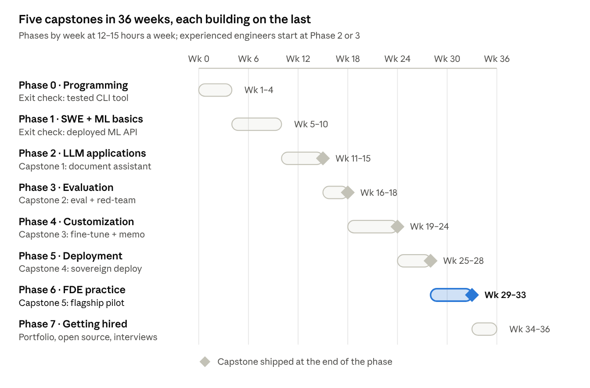

# Forward Deployed ML Engineer: Zero-to-Hired Curriculum

Last reviewed: 2026-10-11 · Sunday Ayandele · [Changelog](CHANGELOG.md)

## How to use this curriculum

This curriculum takes a learner from basic programming to a hireable Forward Deployed ML Engineer (FDE) in about 36 weeks at 12–15 hours a week. Every phase ends in a capstone that produces public evidence an FDE hiring loop actually checks: shipped code, eval numbers, a deployment, and a customer-style write-up.

**Who it is for**

- **From zero:** comfortable with a computer, little or no programming. Start at Phase 0 and do everything.
- **Software or data engineers:** skip Phase 0, test out of Phase 1 with its exit check, start at Phase 2 (about 24 weeks).
- **Experienced platform or cloud engineers:** fast-track. Do Phases 3–7 and Capstones 2–5 (about 12–16 weeks).

**Three rules that run through every phase**

1. **Evidence over certificates.** Each capstone has a definition of done and a public artefact. Hiring loops read repos, eval tables and write-ups, not course completions.
2. **Eval before build.** From Phase 3 on, no system is "done" without a measured baseline and a measured improvement.
3. **Talk like a deployer.** Every capstone ends with a one-page customer brief: the problem, the trade-offs, the cost and what you would do next.

The capstones build on one another. Pick **one domain** in Phase 2 (for example banking KYC, insurance claims, recruiting or public-sector document search) and keep it through Capstone 5, so the portfolio reads as one coherent customer engagement.

## What the market asks for

Across 15 public FDE postings reviewed in October 2026, every role asks for the same core (production Python, shipped LLM systems, evaluation, customer communication) and then splits into four families by how deep into the model or the infrastructure you go.

| Company | Role | Family | Signature requirements | Experience |
| --- | --- | --- | --- | --- |
| [Mistral AI](https://jobs.lever.co/mistral/77f6fd1b-65cf-45d8-9b68-594c62732f62) | Applied AI, Forward Deployed ML Engineer (EMEA) | ML-heavy | Fine-tuning, advanced RAG or agents, PyTorch, open-source LLM contributions, pre-sales | 2+ yrs IC |
| [Mistral AI](https://jobs.lever.co/mistral/fbd01aee-5831-48f0-984d-abbce728a2c5) | Senior/Staff Forward Deployed ML Engineer | ML-heavy | Same core plus products at large user scale | 7–10+ yrs |
| [Reflection AI](https://jobright.ai/jobs/info/69e81b5b0a6e09555302e5e5) | FDE, LLM Post-training | ML-heavy | SFT, preference optimization, RL fine-tuning, eval suites, cloud/VPC/on-prem deploys | Shipped a fine-tuned model |
| [Modal](https://seedtable.com/jobs/33412) | Forward Deployed Engineer, ML | ML-heavy | vLLM/SGLang serving, TRL/verl training, GPU work, open-source | 2+ yrs ML eng |
| [Hugging Face](https://startup.jobs/cloud-machine-learning-engineer-us-remote-hugging-face-3935595) | Cloud ML Engineer | ML-heavy | Transformers, PEFT, Accelerate, PyTorch, cloud ML, Docker | Not stated |
| [OpenAI](https://www.remotedxb.com/job/forward-deployed-engineer-openai--407934) | Forward Deployed Engineer (Abu Dhabi) | API / agent | Prototype to production, full-stack, LLM systems, 50% travel | 5+ yrs |
| [Anthropic](https://agentic-engineering-jobs.com/jobs/anthropic-forward-deployed-engineer-applied-ai-uk-yiEH3A) | FDE, Applied AI (UK) | API / agent | MCP servers, sub-agents, agent skills, prompting and evals, Python + TypeScript | 4+ yrs customer-facing |
| [Anthropic](https://agentic-engineering-jobs.com/jobs/anthropic-forward-deployed-engineer-applied-ai-germany-ZFxC2Z) | FDE, Applied AI (Germany) | API / agent | As UK plus native or C1 German | 4+ yrs |
| [Google DeepMind](https://jobs.anitab.org/companies/google-24698/jobs/89985174-forward-deployed-engineer-deepmind) | Forward Deployed Engineer | API / agent | Joint evals on partner data, complex RAG, multimodal, case studies | 5 yrs SWE |
| [Databricks](https://builtin.com/job/ai-engineer/6775575) | AI Engineer, FDE | API / agent | RAG, multi-agent, Text2SQL, fine-tuning, DSPy, PyTorch, conference talks | "Extensive" |
| [ElevenLabs](https://www.workingnomads.com/jobs/forward-deployed-engineer-software-engineer-elevenlabs-1832702) | FDE, Software Engineer | API / agent | Python, API integration, end-to-end delivery, regional language | Mid level |
| [Cohere](https://www.remotedxb.com/job/forward-deployed-engineer-agentic-platform-cohere-3) | FDE, Agentic Platform | Platform / private deploy | RAG and agents, private/on-prem deployment, cloud networking | Mid–senior |
| [Scale AI](https://jobs.accel.com/companies/scale-ai/jobs/85425637-sr-staff-ml-forward-deployed-engineer-enterprise-genai) | Sr Staff ML FDE, Enterprise GenAI | Platform / private deploy | LLMs, vector DBs, Kubernetes, cloud, Python/TS + SQL | 7+ yrs |
| [Palantir](https://jobs.lever.co/palantir/bf718bd3-b2ef-451e-8033-cb4d2d9c094b) | Forward Deployed Software Engineer (Warsaw) | Classic data FDSE | Data-driven solutions, custom web apps, executive meetings, clearance | Graduate-friendly |
| [Cornerstone](https://jobs.institutedata.com/job/5039353/forward-deployment-engineer-united-states/) | Forward Deployment Engineer | API / agent | GenAI and agentic integrations, scripts and APIs | 1–2 yrs |

**What this means for the curriculum**

- **Shared core (every family):** Python, APIs and backend, RAG, agents, evaluation, cloud, and explaining trade-offs to customers. Phases 1–3 and 6.
- **ML-heavy (Mistral, Reflection, Modal, Hugging Face):** PyTorch, fine-tuning (SFT, DPO), serving with vLLM, open-source contributions. Phases 4–5.
- **Platform / private deploy (Cohere, Scale):** Kubernetes, VPC and on-prem rollout, networking, security reviews. Phase 5.
- **Common extras:** a second business language for regional roles (German, Mandarin, Polish), 25–50% travel, and public writing such as case studies or talks.

The hiring loop is consistent across companies: a coding round, a **decomposition round** where the interviewer plays an evasive customer, and a values or behavioural round. Write-ups of these loops consistently describe the decomposition round as the deciding one ([source](https://www.techinterview.org/post/3233477236/forward-deployed-engineer-interview/)).

## Curriculum at a glance

Eight phases over 36 weeks produce five capstones; each capstone reuses the one before, so by week 33 they form a single end-to-end customer engagement.

The flagship pilot in Phase 6 combines everything built earlier and becomes your main interview story.

## Phases 0–1: Foundations (weeks 1–10)

The goal is to write clean, tested Python, ship a small web API to the cloud, and explain how a neural network learns. Every FDE posting treats this as assumed, not taught.

### Phase 0: Programming and tooling (weeks 1–4)

| Week | Topic | What you do |
| --- | --- | --- |
| 1 | Python basics | Types, control flow, functions, files, errors. Solve 20 small exercises. |
| 2 | Python for real work | Classes, modules, virtual environments, `pip`/`uv`, typing, `pytest`. |
| 3 | Developer tooling | Git and GitHub (branches, PRs), Linux shell, VS Code, Docker basics. |
| 4 | Data handling | JSON, CSV, SQL (SELECT, JOIN, GROUP BY), pandas, calling REST APIs with `httpx`. |

**Resources:** Harvard CS50P (Python), *The Missing Semester* (MIT, shell and Git), SQLBolt.

**Exit check:** a public GitHub repo with a tested command-line tool that pulls data from a public API, stores it in SQLite and prints a report. CI runs the tests on every push.

### Phase 1: Software engineering and ML foundations (weeks 5–10)

| Week | Topic | What you do |
| --- | --- | --- |
| 5 | Backend APIs | FastAPI, Pydantic, async, auth basics, OpenAPI docs. |
| 6 | Front-end just enough | Basic React or Streamlit/Gradio; call your API from a UI. |
| 7 | Cloud and deployment | Deploy a container to one cloud (AWS, Azure or GCP); secrets, logging, IAM basics. |
| 8 | Maths for ML | Vectors, matrices, dot products, gradients, probability and softmax. Intuition, not proofs. |
| 9 | Classical ML | Train/test split, overfitting, metrics (precision, recall, F1), scikit-learn on a tabular dataset. |
| 10 | Neural networks | Build a tiny network and backpropagation from scratch, then the same in PyTorch. |

**Resources:** FastAPI official tutorial; 3Blue1Brown *Essence of Linear Algebra* and *Neural Networks*; Andrej Karpathy *Neural Networks: Zero to Hero* (first videos); fast.ai *Practical Deep Learning for Coders*.

**Exit check:** a deployed FastAPI service with a small UI that serves a scikit-learn or PyTorch model, plus a README explaining the metric you chose and why. If you can already do this, skip to Phase 2.

## Phase 2: LLM application engineering (weeks 11–15)

The goal is to build retrieval and agent systems on hosted model APIs that hold up on messy enterprise documents. This is the shared core of every FDE family.

| Week | Topic | What you do |
| --- | --- | --- |
| 11 | How LLMs behave | Tokens, context windows, temperature, cost per call. Prompting patterns: few-shot, structured output, chain of thought. Use at least two providers (for example Mistral and one other). |
| 12 | RAG fundamentals | Document parsing (PDF, tables, OCR), chunking strategies, embeddings, a vector store (pgvector or Qdrant). |
| 13 | Advanced RAG | Hybrid search (BM25 + dense), reranking, query rewriting, metadata filters, citations back to sources. |
| 14 | Agents and tools | Function calling, JSON schemas, ReAct and plan-and-execute loops, an orchestration framework (LangGraph or similar), MCP servers. |
| 15 | Capstone 1 build week | Ship Capstone 1. |

**Resources:** provider docs (Mistral, OpenAI, Anthropic cookbooks); Hugging Face LLM Course; the MCP specification and SDK examples; LangGraph tutorials.

### Capstone 1: Enterprise document assistant

**Brief:** a domain team (pick your domain) wastes hours searching policy and procedure PDFs. Build an assistant that answers questions with citations and refuses when the documents do not contain the answer.

**Must include**

- Ingestion of at least 200 real public documents in your domain (regulations, policies, annual reports), including tables.
- Hybrid retrieval with a reranker, and every answer citing the source page.
- One agentic tool, for example a structured lookup or calculator, exposed through an MCP server.
- A FastAPI backend with streaming, and a simple UI.

**Definition of done:** a public repo, a 2-minute demo video, and a README with an architecture diagram and known failure cases.

**Proves:** RAG, agents, MCP, API and front-end delivery. These match requirements in the Anthropic, Cohere, Databricks and Mistral postings.

## Phase 3: Evaluation and reliability (weeks 16–18)

The goal is to prove with numbers whether an LLM system works, and to catch regressions before a customer does. Interviewers repeatedly ask how you know a system works beyond "it looks right"; this phase is your answer.

| Week | Topic | What you do |
| --- | --- | --- |
| 16 | Eval design | Define the business metric first. Build a 150–200 item golden set with easy, hard and adversarial cases. Retrieval metrics (recall@k, MRR) and answer metrics (faithfulness, correctness). |
| 17 | LLM-as-judge and guardrails | Write a rubric, calibrate the judge against about 50 hand labels, sample by stratum. Add input/output guardrails, prompt-injection tests and refusal behaviour. |
| 18 | Observability and regression | Tracing (Langfuse, LangSmith or OpenTelemetry), token cost and latency dashboards, eval suite in CI on every change. Ship Capstone 2. |

**Resources:** Hamel Husain's writing on LLM evals; RAGAS and DeepEval docs; OWASP Top 10 for LLM Applications.

### Capstone 2: Eval harness and red-team report for Capstone 1

**Brief:** the customer's risk team will not approve Capstone 1 without evidence. Produce that evidence.

**Must include**

- A versioned golden set and an eval harness that scores prompt-only, basic RAG and advanced RAG side by side.
- An LLM judge with its agreement rate against human labels reported.
- A red-team suite (prompt injection through documents, out-of-scope questions, PII leakage) with pass/fail results.
- A CI job that fails the build if a key metric drops.

**Definition of done:** a results table in the README, a dashboard screenshot, and a one-page "release readiness" memo written for a non-technical risk owner.

**Proves:** the evaluation depth named in the Anthropic, Databricks, DeepMind and Reflection postings, and the strongest single answer in an FDE interview.

## Phase 4: Model customization (weeks 19–24)

The goal is to fine-tune an open-weight model, prove it beats prompting and RAG on a task a customer cares about, and know when it is not worth doing. This phase separates an ML-heavy FDE (Mistral, Reflection, Modal, Hugging Face) from an API-only one.

| Week | Topic | What you do |
| --- | --- | --- |
| 19 | PyTorch for LLMs | Tensors, autograd, training loop, mixed precision, data loaders, GPU memory basics. Write a training loop from scratch. |
| 20 | Transformer internals | Attention, positional encodings, KV cache, tokenizers, mixture-of-experts. Implement attention in a notebook; read the Mistral 7B and Mixtral papers. |
| 21 | Data for fine-tuning | Task framing, chat templates, cleaning and dedup, synthetic data generation and filtering, a data card. |
| 22 | Supervised fine-tuning | LoRA and QLoRA with Hugging Face TRL/PEFT or mistral-finetune; hyper-parameters, run tracking, error analysis. |
| 23 | Preference tuning | DPO (and ORPO as a variant) on top of SFT; awareness of RL fine-tuning and when it pays off. |
| 24 | Decision and Capstone 3 | Compare prompt vs RAG vs SFT vs SFT+DPO on quality, latency and cost. Ship Capstone 3. |

**Resources:** Karpathy *Let's build GPT* and *Let's build the GPT tokenizer*; the Hugging Face LLM Course fine-tuning chapters; TRL and PEFT docs; Sebastian Raschka *Build a Large Language Model (From Scratch)*.

**Compute:** a single rented 24–48 GB GPU is enough for a 7B-class model with QLoRA. Budget your GPU hours before you start and track spend per run.

### Capstone 3: Domain fine-tune with a defended decision

**Brief:** the customer's task (for example extracting fields from KYC documents, classifying claims, or answering in a strict house style) is not solved well enough by prompting. Decide whether fine-tuning is worth it and prove it.

**Must include**

- A curated SFT dataset and a preference dataset, both with data cards.
- A LoRA/QLoRA fine-tune of a small open Mistral model, then a DPO pass.
- The Capstone 2 harness re-used to score four variants: prompt-only, RAG, SFT, SFT+DPO.
- A decision memo: which variant you would deploy, with numbers for quality, latency and cost per 1,000 requests.

**Definition of done:** model adapter on the Hugging Face Hub with a model card, training code in the repo, and the memo. A fine-tune that does not win is still a pass if the memo explains why.

**Proves:** fine-tuning, PyTorch and the prompt-vs-RAG-vs-fine-tune judgement asked for by Mistral, Reflection and Databricks.

## Phase 5: Inference, deployment and sovereign AI (weeks 25–28)

The goal is to run your own model inside a customer-like environment at a known cost, latency and security posture. Mistral, Cohere, Reflection and Scale all ask for VPC or on-prem deployment, and Modal asks for vLLM/SGLang depth.

| Week | Topic | What you do |
| --- | --- | --- |
| 25 | LLM serving | vLLM (and a look at SGLang or TGI): continuous batching, KV cache, LoRA adapters at serve time, OpenAI-compatible endpoints. Benchmark throughput and p95 latency. |
| 26 | Quantization and sizing | AWQ, GPTQ and FP8; GPU memory maths; cost per 1,000 requests across GPU types. |
| 27 | Kubernetes for GPUs | Containers, Helm, GPU operator, autoscaling, rollout and rollback of model versions (Kubernetes or OpenShift). |
| 28 | Sovereign and enterprise deployment | Private networking, air-gapped installs, secrets, SSO, audit logging, data residency, GDPR and EU AI Act awareness. Ship Capstone 4. |

**Resources:** vLLM and SGLang docs; NVIDIA GPU Operator docs; Kubernetes official tutorials; Chip Huyen *AI Engineering*.

### Capstone 4: Sovereign deployment of your fine-tuned model

**Brief:** a regulated customer (bank, hospital or public body) cannot send data to a public API. Deploy the Capstone 3 model and the Capstone 1 assistant inside a private environment.

**Must include**

- vLLM serving the base model plus your LoRA adapter, in full precision and one quantized variant.
- Kubernetes manifests or Helm chart, with no outbound internet needed at runtime.
- A benchmark table: tokens/second, p95 latency, GPU memory, cost per 1,000 requests.
- A reference architecture document covering networking, identity, logging and data residency.

**Definition of done:** reproducible deployment from the repo, benchmark notebook, and an architecture document a customer security team could review.

**Proves:** serving, quantization, Kubernetes and private deployment, the main gap between an application engineer and an FDE trusted with regulated customers.

## Phase 6: Forward-deployed practice (weeks 29–33)

The goal is to behave like an FDE in front of a customer: turn a vague problem into a scoped plan, run a pilot, and hand back something the product team can reuse. Write-ups of FDE loops say case work and customer judgement make up roughly half the evaluation.

| Week | Topic | What you do |
| --- | --- | --- |
| 29 | Discovery and decomposition | Stakeholder mapping, discovery questions, separating the stated ask from the real problem, writing a one-page scope with a success metric. |
| 30 | Solution design and ROI | Architecture options with trade-offs, build vs buy, cost model, risk register, pilot success criteria agreed before building. |
| 31 | Pre-sales and communication | Technical demos, explaining LLM limits to executives, handling objections (data privacy, hallucination, cost). |
| 32–33 | Flagship capstone | Ship Capstone 5 and present it. |

**Resources:** Palantir's public material on the forward-deployed model; Exponent's FDE interview guide; *The Mom Test* by Rob Fitzpatrick for discovery interviews.

### Capstone 5 (flagship): End-to-end pilot for a real organisation

**Brief:** run a real, scoped pilot for an organisation that has the problem: a non-profit, a small business, your employer (with permission) or a public-sector open-data team. If no real partner is available, a peer plays the customer and stays in role throughout.

**Must include**

1. **Discovery:** notes from at least two stakeholder conversations and a one-page scope with a measurable success metric.
2. **Build:** an agentic workflow combining your Capstone 1–4 components (served model, retrieval, tools via MCP, guardrails) on the partner's real or representative data.
3. **Evaluate:** the Capstone 2 harness adapted to the partner's success metric, with before/after numbers.
4. **Deploy:** running in an environment the partner controls, or a documented hand-off package if not.
5. **Hand back:** a reusable playbook (what to repeat, what to avoid) and a 15-minute presentation to the partner's decision-maker.

**Definition of done:** a written case study with architecture, metrics and ROI; a recorded presentation; and, where possible, a short quote or reference from the partner.

**Proves:** the whole FDE job end to end. In interviews this becomes your main story for the decomposition, project deep-dive and behavioural rounds.

## Phase 7: Getting hired (weeks 34–36, then ongoing)

The goal is to turn five capstones into interviews and offers. Start the open-source and writing tracks earlier (from Phase 4) so they are visible by now.

### Portfolio and visibility

- **One portfolio page** linking the five capstones, each with a one-line result (for example "SFT+DPO beat RAG by X points at Y% lower cost").
- **Open source:** at least one merged or open PR to an LLM project you used (vLLM, TRL, PEFT, a Mistral repo, an eval library). Bug fixes, examples and docs all count. Mistral, Modal and Hugging Face name open-source contributions explicitly.
- **Public writing:** two technical posts (the Capstone 3 decision memo and the Capstone 5 case study). DeepMind and Databricks list case studies, blogs or talks.
- **CV:** lead each role with outcomes and numbers; add an "AI deployments" section listing the capstones as engagements.

### Interview loop preparation

| Round | What it tests | How to prepare |
| --- | --- | --- |
| Recruiter / hiring manager | Motivation, customer-facing history, travel and location fit | A 90-second story of why FDE, built around Capstone 5. |
| Coding | Practical Python: parse messy data, call an API, build a small LLM pipeline | Timed exercises building data + LLM pipelines from scratch; review LeetCode medium basics. |
| Decomposition / case | Turning a vague customer problem into a scoped, buildable plan, live | Practise 10 cases out loud with a partner playing an evasive stakeholder. Structure: clarify goal → users → data → constraints → options → MVP → metric → risks. |
| Technical deep-dive | Depth on one project: trade-offs, failures, numbers | Rehearse Capstone 3 and 5: why fine-tune or not, eval design, what broke. |
| LLM system design | RAG at scale, latency budgets, eval and guardrails, private deployment | Practise prompts like "cut a 1.5 s RAG pipeline to under 300 ms" and "deploy for a bank with no internet egress". |
| Values / behavioural | Ownership, ambiguity, low ego, honesty with customers | Five STAR stories: a failure, a pushback on a customer, an ambiguous win, a cross-team fix, a fast learn. |

### Applications

1. Shortlist 15–20 roles across the four families, weighted to where your capstones are strongest.
2. For each, map the posting's requirements to specific capstone evidence before applying.
3. Seek referrals: comment on and contribute to the company's open-source repos, attend their meetups and hackathons.
4. Track every application, round and piece of feedback; re-run a mock case after every rejection.
5. Apply in waves of 4–5 so interviews cluster and offers can be compared.

## Capstone rubric and evidence checklist

Score every capstone on five criteria from 1 to 4; a capstone passes at 14 of 20 with no criterion below 2. Have a peer or mentor score it, not only yourself.

| Criterion | 1 · Not yet | 2 · Developing | 3 · Hireable | 4 · Standout |
| --- | --- | --- | --- | --- |
| Problem framing | No stated user or metric | Metric stated after the build | Metric agreed before building, tied to a business outcome | Metric validated with a real stakeholder |
| Engineering quality | Runs only on your machine | Runs from README with effort | Reproducible, tested, CI green | Clean abstractions others could reuse |
| Evidence | Screenshots and claims | One headline number | Baseline vs improvement with method explained | Multiple metrics, error analysis, failure cases shown |
| Deployment | Notebook only | Local container | Deployed with monitoring | Private or production-like, with security notes |
| Communication | Code only | README describes what | README explains why and trade-offs | Customer-ready brief or talk a non-engineer understands |

### Evidence checklist (by the end of Phase 7)

- [ ] Capstone 1: public repo, demo video, architecture diagram
- [ ] Capstone 2: eval results table, CI eval job, release-readiness memo
- [ ] Capstone 3: model card on the Hugging Face Hub, four-variant comparison, decision memo
- [ ] Capstone 4: Helm chart or manifests, benchmark table, reference architecture
- [ ] Capstone 5: case study, recorded presentation, partner quote or reference
- [ ] At least one open-source PR to an LLM project
- [ ] Two published technical posts
- [ ] Portfolio page and outcome-led CV
- [ ] Ten recorded mock decomposition cases
- [ ] Five rehearsed STAR stories

## Sources

Postings were read in October 2026; several were already closed and are cited as evidence of requirements, not as open roles.
- [Reflection AI: FDE, LLM Post-training](https://jobright.ai/jobs/info/69e81b5b0a6e09555302e5e5)
- [Modal: Forward Deployed Engineer, ML](https://seedtable.com/jobs/33412)
- [OpenAI: Forward Deployed Engineer, Abu Dhabi](https://www.remotedxb.com/job/forward-deployed-engineer-openai--407934)
- [Anthropic: FDE, Applied AI (UK)](https://agentic-engineering-jobs.com/jobs/anthropic-forward-deployed-engineer-applied-ai-uk-yiEH3A)
- [Anthropic: FDE, Applied AI (Germany)](https://agentic-engineering-jobs.com/jobs/anthropic-forward-deployed-engineer-applied-ai-germany-ZFxC2Z)
- [Google DeepMind: Forward Deployed Engineer](https://jobs.anitab.org/companies/google-24698/jobs/89985174-forward-deployed-engineer-deepmind)
- [Databricks: AI Engineer, FDE](https://builtin.com/job/ai-engineer/6775575)
- [ElevenLabs: FDE, Software Engineer](https://www.workingnomads.com/jobs/forward-deployed-engineer-software-engineer-elevenlabs-1832702)
- [Cohere: FDE, Agentic Platform](https://www.remotedxb.com/job/forward-deployed-engineer-agentic-platform-cohere-3)
- [Scale AI: Sr Staff ML FDE, Enterprise GenAI](https://jobs.accel.com/companies/scale-ai/jobs/85425637-sr-staff-ml-forward-deployed-engineer-enterprise-genai)
- [Palantir: Forward Deployed Software Engineer (Warsaw)](https://jobs.lever.co/palantir/bf718bd3-b2ef-451e-8033-cb4d2d9c094b)
- [Cornerstone: Forward Deployment Engineer](https://jobs.institutedata.com/job/5039353/forward-deployment-engineer-united-states/)
- [techinterview.org: What the FDE interview really tests](https://www.techinterview.org/post/3233477236/forward-deployed-engineer-interview/)
- [Exponent: FDE Interview Definitive 2026 Guide](https://www.tryexponent.com/blog/forward-deployed-engineer-interview-the-definitive-2026-guide-fde)
- [AI Engineering Insider: Cracking the FDE interview](https://aiengineeringinsider.substack.com/p/cracking-the-forward-deployed-ai)
