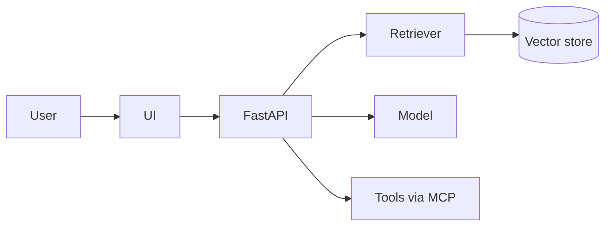

# <Capstone N>: <Project name>

> One sentence: who this is for and the result, with a number.
> Example: "Policy assistant for a claims team: answers 87% of golden-set questions correctly with citations, at €0.40 per 1,000 queries."

**Demo:** <link to 2-minute video> · **Customer brief:** `brief.md` (link it in your repo) · **Domain:** <your domain>

## Problem

- **User:** who uses this and what they do today instead.
- **Pain:** what it costs them (time, errors, money).
- **Success metric:** agreed before building, and the bar it must hit.

## Architecture

<!-- Add a diagram (Mermaid, Excalidraw or PNG) showing components and data flow. -->



## Results

| Variant | Key metric | Secondary metric | p95 latency | Cost / 1k requests |
| --- | --- | --- | --- | --- |
| Baseline | | | | |
| This version | | | | |

How the numbers were produced: dataset, size, judge or labels, date.

## Known failure cases

- <case>: why it fails, and what you would try next.

## Run it

```bash
git clone <repo>
cp .env.example .env   # add keys; never commit .env
uv sync                # or pip install -r requirements.txt
make test && make run
```

## Trade-offs and decisions

- <decision>: options considered, why this one, what it costs.

## What I would do next

1.
2.

## Rubric self-score

| Criterion | Score (1–4) | Evidence |
| --- | --- | --- |
| Problem framing | | |
| Engineering quality | | |
| Evidence | | |
| Deployment | | |
| Communication | | |
